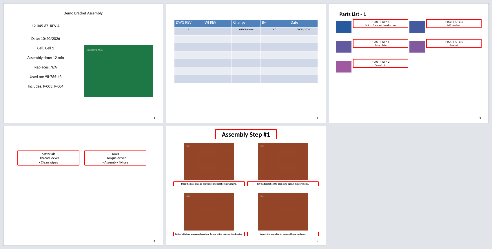

# WIG: Work Instruction Generator

Builds a manufacturing work-instruction PowerPoint from an Excel workbook and a folder of images.

You fill in one workbook per assembly (title info, parts, equipment, steps), drop in one picture per
part and per step, and run one command. WIG fills your PowerPoint template, lays the steps out two,
four or eight to a slide, and numbers the slides. On a revision it keeps the old revision log, adds a
row for the new revision, and moves the superseded deck into a `CANCELLED` folder, so the assembly
folder always holds exactly one current instruction.



*Demo output: made-up parts and plain placeholder pictures, so it shows the layout, not a finished deck.*

**Status:** working prototype. 51 automated tests (unit tests, end-to-end builds against synthetic
templates, and the command line); a GitHub Actions workflow is set up to run them on Linux and
Windows once the repo is public. Every bug found so far is listed in
[Bugs fixed](#bugs-fixed), each with a regression test. It has only been run on synthetic data, not on
a production folder, and only the layout in the demo has been checked by eye. Expect rough edges around
your own template.

## Try it in two minutes

Python 3.9 or newer.

```bash
pip install -r requirements.txt
python examples/make_demo.py            # add --pdf to also get a PDF (needs LibreOffice)
```

This builds a small made-up project in `demo/` (template, workbook, placeholder images), runs the
generator on it and writes `demo/Design Folder/12/12-345-67/12-345-67 REV A.pptx`. Open that file to
see the output. `examples/make_demo.py` is short: read it to see exactly how the inputs fit together.

To install the `wig` command instead of running the script by path:

```bash
pip install .
wig --help
```

Everything below works the same as `python generate_work_instruction.py ...`.

## Start your own project

```bash
wig --init my-wi-project            # empty skeleton: folders, starter template, blank workbook
wig --init my-wi-project --sample   # the same, plus one made-up assembly you can build immediately
```

`--init` creates the folders below, a plain starter template that meets the
[slide-order contract](#template), and `Templates/assembly-workbook-template.xlsx` (the right sheets
and headers, no data). Copy the workbook into `Design Folder/<prefix>/<assembly number>/`, rename it to
the assembly number, fill it in, add the images, then restyle the template in PowerPoint. Keep the
slide order and the `{placeholders}`.

## Using it on your own files

```bash
wig --assembly 12-345-67 \
    --design-folder "D:/Shared/Design Folder" \
    --part-images-folder "D:/Shared/Part_Catalog_Images" \
    --template-path "D:/Shared/Templates/XX-XXX-XX REV XX.pptx"
```

The three folder flags are optional (without them WIG looks next to the script, or uses `--config`).
Anything you don't give as a flag it asks for:

| Question | Flag to skip it |
|---|---|
| Assembly number | `--assembly 12-345-67` |
| Reviser initials (go in the revision log) | `--initials CD` |
| Is welding used? `Y` keeps the welding slide, `N` removes it | `--welding Y` or `--welding N` |
| Steps per slide: 2, 4 or 8 | `--steps-per-slide 4` |
| Initial release, or revision | `--initial-release`, or `--revision D.2 --change-description "Updated torque spec"` |

Bad answers are re-asked up to three times. Missing folders, images or required cells are all reported
together before anything is written, not one at a time. Errors print as a one-line `ERROR:` message
and the exit code is 1, so it behaves in scripts.

**Non-interactive example** (no prompts at all):

```bash
wig --assembly 12-345-67 --initials CD --welding N --steps-per-slide 4 --initial-release
```

### Batch mode

Give several numbers, or a file with one number per line (blank lines and `# comments` are skipped):

```bash
wig --assembly 12-345-67 12-345-68 12-345-69 --initials CD --welding N --steps-per-slide 4 --initial-release
wig --assembly-file assemblies.txt --initials CD --welding N --steps-per-slide 4 --initial-release
```

The answers apply to every assembly in the run, so batch suits initial releases or a group of
assemblies that move to the same revision together. A failed assembly doesn't stop the others. WIG
builds the rest, then lists each failure and exits with 1.

### PDF export

```bash
wig --assembly 12-345-67 ... --pdf
```

Writes `<deck>.pdf` next to the deck using headless LibreOffice (`soffice` on your `PATH`, or set
`SOFFICE_BIN`). If LibreOffice isn't installed, `--pdf` fails before anything is built.

### Folder layout

```
Part_Catalog_Images/
    <part number>.png            one per part, plus <assembly number>.png for the cover picture
Design Folder/
    <prefix>/                    the part of the assembly number before the first "-"
        <assembly number>/
            <assembly number>.xlsx
            Assembly/<step number>.png
            Testing/<step number>.png       optional
            Packaging/<step number>.png     optional
            CANCELLED/                      created on the first revision
Templates/
    XX-XXX-XX REV XX.pptx
```

Images can be `.png`, `.jpg` or `.jpeg`. The file name must match the part, assembly or step number
exactly.

### Workbook

One workbook per assembly. Columns are read **by position**, not by header text, so the header row can
say whatever your team prefers. Row 1 is a header, data starts on row 2. If a recognised header
turns up in the wrong column (for example someone swapped two), WIG prints a warning.

| Sheet | Columns, left to right |
|---|---|
| `Title Info` (one data row) | WI # · WI Title · REV # · PRODUCTION CELL · FORMER WI# · ASSEMBLY TIME · Parent Assemblies |
| `Parts` | Part # · BOMNAME · Quantity · Part Name |
| `Equipment` | Materials · Tools |
| `Assembly` | Step # · Description |
| `Testing`, `Packaging` (optional) | Step # · Description |

- `REV #` is written `<drawing revision>.<instruction revision>`, for example `D.2`. A bare `A` also works.
- Parts with `BOMNAME` = `MFG BOM` are listed as included subassemblies on the cover slide.
- Long step descriptions grow their text box downward instead of shrinking the font.

### Template

WIG edits your PowerPoint rather than drawing its own, so the template has to follow a fixed slide
order. Slides are found by position (counting from 0):

| Slide | Contents |
|---|---|
| 0 | Cover. Placeholders: `{TITLE}` `{Assembly Number}` `{REV}` `{DATE}` `{CELL}` `{FORMER}` `{TIME}` `{PARENT_ASSEMBLIES}` `{INCLUDED_SUBASSEMBLIES}` |
| 1 | Revision log: a table with columns DWG REV, WI REV, Change, By, Date. It needs a spare row for each revision you expect. |
| 2 | Optional page, for example "Cycle Time". Kept as-is unless it contains "Leave page blank if no data" and the words "Cycle Time" or "Size and Weight", in which case it is dropped. |
| 3 | Welding. Removed when you answer `N`. |
| 4 | Parts list template. Copied once per ten parts. |
| 5 | Equipment (materials and tools). |
| 6 | Assembly steps template. Copied once per 2, 4 or 8 steps. |
| 7 | Optional page, for example "Size and Weight". Same rule as slide 2. |
| 8 | Testing steps. Removed if the workbook has no `Testing` rows. |
| 9 | Packaging steps. Removed if the workbook has no `Packaging` rows. |

`wig --init` builds a minimal template that meets this, which is the quickest way to see it in
practice.

### A template with a different slide order

If your template doesn't follow the order above, describe it in a JSON file and pass `--config`:

```json
{
  "slides": {"title": 0, "revision_log": 1, "welding": 3, "parts": 4,
             "equipment": 5, "assembly": 6, "testing": 8, "packaging": 9},
  "paths": {"design_folder": "Design Folder", "template_path": "Templates/our template.pptx"}
}
```

Any key can be left out. Relative paths resolve against the config file, and command-line flags still
win. WIG checks the file and refuses a layout it can't build: unknown keys, two slides at one
position, or sections out of order. The order must be welding, parts, equipment, assembly, testing,
packaging, with title and revision log ahead of welding. WIG copies pages as sections grow, so that
order can't change. If the template is shorter than the layout expects, you get an error naming the
template instead of a crash.

## How the code is organised

Everything is in `generate_work_instruction.py`, in numbered sections:

1. Paths and file conventions
2. Excel format requirements
3. PowerPoint template settings
4. Data containers and the `PROCESS_SECTIONS` table
5. onward: reading and validating the workbook, editing slides, saving
6. Last: `--config` loading, PDF export, and the command line (`main`)

`wig_scaffold.py` holds the starter template, workbook and sample data used by `--init` and the demo.

Adding another process section (say, Inspection) is one entry in `PROCESS_SECTIONS` plus one template
slide.

## Tests

```bash
python -m unittest discover -s tests
```

`tests/test_generate_work_instruction.py` covers the logic and full deck builds. `tests/test_cli.py`
covers flags, prompts, batch mode, `--init`, `--config` and `--pdf`. The PDF test is skipped when
LibreOffice isn't installed. The GitHub Actions workflow (`.github/workflows/tests.yml`) runs everything on Linux and Windows
(Python 3.9, 3.12 and 3.13) and builds the demo deck. So far only Python 3.11, 3.12 and 3.13 on Linux have been run.

## Limitations

- Tested on synthetic data only. No one has yet run it against a real production folder.
- The layout inside each slide (card positions, text sizes, 2/4/8-step grids) is fixed in the code.
  `--config` moves *which slide is which*, but changing how a page is laid out means editing the
  constants.
- The process-slide title counts slides, not steps: with four steps per slide the first page is titled
  "Assembly Step #1" and the second "Assembly Step #2". Whether it should read as a step range is an
  open question.
- The input conventions (`BOMNAME`, `MFG BOM`, `PRODUCTION CELL`, `DWG REV`, the folder layout) come from
  one shop's way of working. They are constants, not configuration.
- A deck that is open in PowerPoint can't be moved to `CANCELLED`. WIG reports which files it couldn't
  move so you can do it by hand.
- Single file, no GUI. PDF export needs LibreOffice, which isn't a Python dependency.

## Bugs fixed

Found by code review (1, 2) and by rendering the demo deck (3). Each has a regression test, and reverting the fix fails it:

1. **Multi-line text formatting.** `add_textbox` applied font size, weight and colour only to the first
   line of multi-line text. python-pptx splits text on `\n` into separate runs, so later lines fell back
   to the theme default. Every part card and the materials/tools box was affected. Every run is now
   formatted.
2. **Broken images after slide duplication.** `duplicate_slide` copies a slide's picture XML but not
   its image relationship, so a picture already on the parts template turned into a broken image on
   every copy (triggered by more than ten parts). Existing pictures are now stripped from the parts
   slide before the part images are added.
3. **Wrong page deleted when welding is unused.** The welding slide was removed by its template
   position *after* a blank optional page (Cycle Time) ahead of it had already been deleted. The
   positions had shifted, so the parts list was deleted and the welding page stayed. Found by rendering
   the demo deck. The welding slide is now tracked by identity, and a test builds a template with the
   blank page ahead of welding.

## License

MIT. See `LICENSE`.
